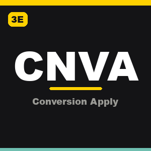

# 3E IPEDS Insights

## View the dashboard

GitHub shows **code** on the tabs below; the app itself runs on **GitHub Pages**.

| | |
|---|---|
| **Live demo (synthetic data)** | **[https://lancecmaben.github.io/ipeds-insights-demo/](https://lancecmaben.github.io/ipeds-insights-demo/)** |
| From this repo | **Code** → right sidebar **About** → **Website** (same URL) |

[](https://lancecmaben.github.io/ipeds-insights-demo/)

---

<details>
<summary><strong>Domo team notes (3enrollment source)</strong></summary>

Client-facing Domo card for **IPEDS Insights — Admissions & Advancement**.

**Repo home:** [`eee_client_insights`](https://github.com/3enrollment/eee_client_insights) → folder `IPEDS_Insights/`  
**Team process:** [../PROCESS.md](../PROCESS.md)

This is the client refresh of the legacy **3E IPEDS Insights** App Studio app (Admissions, Advancement, and FAQ). The internal summary card is a separate app and is not in this folder.

## Current release

| | Value |
|---|--------|
| **Design version** | Match `version` in [`manifest.json`](./manifest.json) after each Prod publish (currently **0.4.67**; Dev and Prod designs and portal cards are pinned to this version) |
| Dev design | `DEV_3E IPEDS Insights` · `094f2030-ec97-4586-a31e-2a5c848b4074` |
| Prod design | `3E IPEDS Insights` · `fefabd63-5f28-46c8-84ef-2fa289d52faa` |
| Prod portal card | Domo card `1175639536` · app instance `cbfb18f2-38ca-4b2f-9352-a7bfae56bfca` |
| Dev portal card | app instance `47ff56f3-c7ef-46b7-93da-19c4454cc560` · same `ipeds` and `migration` dataset ids as Prod |

**Admissions filters:** Institution and survey year on the left; comparison filters (conference, region, control, institutions, state, selectivity) on the right. No partition filter on Admissions.

**Default peers:** Valid conference, else state + control; non-groupable values (`Not applicable`, `N/A`, etc.) are ignored. Comparison subtitles show the active peer definition and institution count. See [DOCUMENTATION.md](./DOCUMENTATION.md) for metric rules (averages, ratio-of-sums, enrollment-weighted discount/Pell).

**Local checks:** `node --check app.js`, `node scripts/peer-helpers.test.js`, `node scripts/check-release.js` (from this folder).

Verify the running build: `<html data-ipeds-version="…">` in DevTools should match the pinned portal `designVersion`.

## Datasets

| Manifest alias | Snowflake view | Used for |
|---|---|---|
| `ipeds` | `MARVIN_ANALYTICS.REPORTING.VW_IPEDS_BETA` · `5bde5389-19ca-4452-acf6-b3241f75453d` | Admissions, yield, tuition, aid, advancement |
| `migration` | `MARVIN_ANALYTICS.REPORTING.VW_IPEDS_MIGRATION_BETA` · `1de6f5ea-6fdb-4e18-a3cc-e64c487445ed` | Residence and migration |

Domo requires **two manifest aliases** (`ipeds` and `migration`) so SQL can hit both views. The portal card must map **both** dataset UUIDs (see pin script below); one alias cannot point at two datasets.

## Publish (from this folder)

```bash
cd IPEDS_Insights

# Dev — bump version in manifest.dev.json first
npx --yes ryuu -m manifest.dev.json publish

# Prod — bump version in manifest.json, then publish (team: from main when merged)
npx --yes ryuu -m manifest.json publish
```

### Pin the ClearSquare portal card (required after Prod publish)

Asset-library **preview** always shows the latest published design. The **portal card** keeps its pinned `designVersion` until you update it.

After Prod publish, set the portal app instance to the same version as `manifest.json` (replace `DESIGN_VERSION` below):

```powershell
node -e "const {Login}=require('C:/Users/LanceMaben/AppData/Local/npm-cache/_npx/1d6bd8ef8acfcf04/node_modules/ryuu/util/login.js'); const v='DESIGN_VERSION'; const appId='cbfb18f2-38ca-4b2f-9352-a7bfae56bfca'; const designId='fefabd63-5f28-46c8-84ef-2fa289d52faa'; const mapping=[{alias:'ipeds',dataSetId:'5bde5389-19ca-4452-acf6-b3241f75453d',fields:[]},{alias:'migration',dataSetId:'1de6f5ea-6fdb-4e18-a3cc-e64c487445ed',fields:[]}]; new Login('3enrollment-marketing.domo.com').getClient().then(c=>c.getDesign(designId,{parts:'versions'}).then(d=>{const ver=d.latestVersion||v; return c.processRequest({url:'/domoapps/apps/v2/'+appId,method:'PUT',data:{id:appId,designId,designVersion:ver,mapping,collections:[],accountMapping:[],actionMapping:[]},headers:{'Content-Type':'application/json',Accept:'application/json'}});})).then(r=>console.log('Pinned',r.designVersion)).catch(e=>console.error(e.response&&e.response.data||e.message));"
```

Hard-refresh ClearSquare (Ctrl+Shift+R) after pin.

**App notes:** [DOCUMENTATION.md](./DOCUMENTATION.md)

</details>
